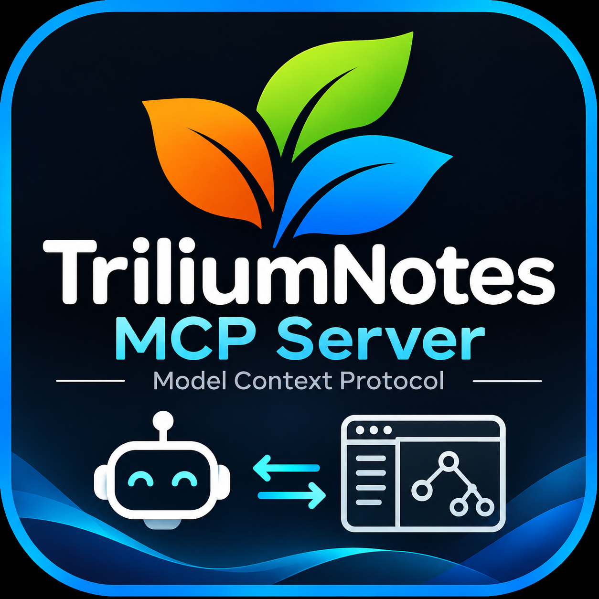

<p align="center">
  
</p>

<h1 align="center">trilium-mcp-server</h1>

<p align="center">
  Let Claude Code and other MCP clients search, read and organize your Trilium Notes.
</p>

<p align="center">
  <a href="LICENSE"></a>
  <a href="https://modelcontextprotocol.io"></a>
  
  <a href="https://docs.triliumnotes.org/user-guide/advanced-usage/etapi/api-reference"></a>
  <a href="https://code.claude.com/docs/en/mcp"></a>
  
  <a href="https://bun.sh"></a>
  <a href="https://github.com/btafoya/triliumnotes-mcp-server/commits/main"></a>
</p>

A [Model Context Protocol](https://modelcontextprotocol.io) server for [Trilium Notes](https://github.com/TriliumNext/Trilium), built on the [ETAPI](https://docs.triliumnotes.org/user-guide/advanced-usage/etapi/api-reference). It lets Claude Code (or any MCP client) search, read, create and organize notes in your Trilium instance.

- 40 tools covering notes, revisions, branches, attributes, attachments, calendar notes and instance admin
- stdio transport, TypeScript, MCP SDK v2
- Destructive tools are annotated so your client can prompt before running them

## Requirements

- [Bun](https://bun.sh) 1.x (runs the TypeScript source directly; Node.js 20.3+ also works after `bun run build`)
- A running Trilium Notes server (TriliumNext) with ETAPI enabled
- An ETAPI token: in Trilium, open **Options -> ETAPI** and create one

## Install

```bash
git clone https://github.com/btafoya/triliumnotes-mcp-server.git
cd triliumnotes-mcp-server
bun install
```

## Use with Claude Code

### Run straight from GitHub with bun (no clone, no build)

The package's `bin` points at the TypeScript source (`src/index.ts`, `#!/usr/bin/env bun`), and bun runs TypeScript natively, so there is nothing to compile:

```bash
claude mcp add \
  --env TRILIUM_URL=http://localhost:8080 \
  --env TRILIUM_ETAPI_TOKEN=<your-token> \
  --transport stdio --scope user \
  trilium -- bunx github:btafoya/triliumnotes-mcp-server
```

bun supports `github:user/repo` specifiers for packages ([docs](https://bun.sh/docs/pm/cli/install)) and `bunx` runs a package's `bin`. Requires [bun](https://bun.sh) on your `PATH`.

### Or run from a local clone

Add it with the Claude Code CLI ([docs](https://code.claude.com/docs/en/mcp)):

```bash
claude mcp add \
  --env TRILIUM_URL=http://localhost:8080 \
  --env TRILIUM_ETAPI_TOKEN=<your-token> \
  --transport stdio --scope user \
  trilium -- bun /absolute/path/to/triliumnotes-mcp-server/src/index.ts
```

- `--` separates Claude's options from the server command; everything after it runs the server.
- `--env` is variadic: it keeps consuming arguments until the next option or `--`. Always put another option (here `--transport stdio --scope user`) after the last `--env` and before the server name. Otherwise the CLI reads the name as another env pair and fails with `Invalid environment variable format: trilium`.
- Short forms: `-t` for `--transport`, `-s` for `--scope`, `-e` for `--env`. Drop `--scope user` for the default `local` scope.

Same thing as JSON:

```bash
claude mcp add-json --scope user trilium '{"type":"stdio","command":"bun","args":["/absolute/path/to/triliumnotes-mcp-server/src/index.ts"],"env":{"TRILIUM_URL":"http://localhost:8080","TRILIUM_ETAPI_TOKEN":"<your-token>"}}'
```

Then confirm it connected:

```bash
claude mcp get trilium
```

If `claude mcp list` shows `Failed to connect`, check that `bun` is on your `PATH`, you ran `bun install`, the path is absolute, and the token is valid.

Scope (where the config is stored):

| Flag | Stored in | Use for |
|---|---|---|
| `-s local` (default) | `~/.claude.json`, this project only | Personal, one project |
| `-s user` | `~/.claude.json`, all projects | Personal, everywhere |
| `-s project` | `.mcp.json` in the repo (shared) | Team setup; never put the token in it |

For a shared `.mcp.json`, reference environment variables instead of the token:

```json
{
  "mcpServers": {
    "trilium": {
      "command": "bunx",
      "args": ["github:btafoya/triliumnotes-mcp-server"],
      "env": {
        "TRILIUM_URL": "${TRILIUM_URL:-http://localhost:8080}",
        "TRILIUM_ETAPI_TOKEN": "${TRILIUM_ETAPI_TOKEN}"
      }
    }
  }
}
```

Verify and manage:

```bash
claude mcp list              # trilium should show as connected
claude mcp get trilium       # show config
claude mcp remove trilium    # unregister
```

Inside a Claude Code session, run `/mcp` to see connection status and the `trilium_*` tools.

### Example prompts

- "Search my Trilium notes for `#project` notes modified this month and summarize them."
- "Create a note under my inbox titled 'Meeting 2026-11-05' with these bullet points."
- "Open today's day note and append a todo list."
- "Find notes tagged `#book` and add the label `read=no` to each that lacks `read`."
- "Snapshot note `<noteId>` as a revision, then rewrite its intro."
- "Export the subtree under `<noteId>` as markdown to `/tmp/export.zip`."

### Permissions

Claude Code asks before each tool call by default. To pre-approve read-only tools, add them to `permissions.allow` in `.claude/settings.json` (or your user settings). MCP tools are named `mcp__<server>__<tool>`, so with the server registered as `trilium`:

```json
{
  "permissions": {
    "allow": [
      "mcp__trilium__trilium_search_notes",
      "mcp__trilium__trilium_get_note",
      "mcp__trilium__trilium_get_note_content",
      "mcp__trilium__trilium_get_app_info"
    ]
  }
}
```

Leave write and delete tools (`create_*`, `set_*`, `update_*`, `delete_*`, `import_zip`, `create_backup`) on prompt.

Other MCP clients: run `bun src/index.ts` (or `node dist/index.js` after `bun run build`) as a stdio server with the same environment variables.

## Configuration

| Variable | Required | Default | Description |
|---|---|---|---|
| `TRILIUM_URL` | no | `http://localhost:8080` | Base URL of the Trilium server. A trailing `/etapi` is stripped. |
| `TRILIUM_ETAPI_TOKEN` | yes | | ETAPI token sent in the `Authorization` header. |

The token grants full access to your notes. Keep it out of version control; this repo ignores `.env`.

## Tools

All tool names are prefixed `trilium_`.

| Area | Tools |
|---|---|
| Notes | `create_note`, `search_notes`, `get_note`, `update_note`, `delete_note`, `undelete_note`, `get_note_history`, `get_note_content`, `set_note_content`, `export_note_subtree`, `import_zip` |
| Revisions | `create_revision`, `list_note_revisions`, `get_revision`, `get_revision_content` |
| Branches | `create_branch`, `get_branch`, `update_branch`, `delete_branch`, `refresh_note_ordering` |
| Attributes | `create_attribute`, `get_attribute`, `update_attribute`, `delete_attribute` |
| Attachments | `list_note_attachments`, `create_attachment`, `get_attachment`, `update_attachment`, `delete_attachment`, `get_attachment_content`, `set_attachment_content` |
| Calendar | `get_inbox_note`, `get_day_note`, `get_week_first_day_note`, `get_week_note`, `get_month_note`, `get_year_note` |
| Application | `get_app_info`, `create_backup`, `get_metrics` |

### Behavior notes

- **Search** uses Trilium search syntax (for example `towers #book`, `"exact phrase"`, `note.dateCreated >= '2025-01-01'`). It returns trimmed metadata; fetch content with `get_note_content`. ETAPI offers `limit` but no `offset`.
- **Content paging:** note, revision and attachment content is returned in chunks of up to 25,000 characters. The response includes `more: call again with offset=N` when there is more.
- **Binary content** is returned base64-encoded. The `set_*_content` tools accept `encoding: "base64"` for binary writes.
- **Export / import** read and write ZIP files at absolute local paths (`output_path`, `zip_path`).
- **Protected notes** appear as `[protected]` and cannot be modified; ETAPI cannot open a protected session.
- **Deleting:** `delete_note` removes a note from every location; `delete_branch` removes it from one (and deletes the note if it was the last). `undelete_note` can restore recent deletions.
- **Not exposed:** `/auth/login` and `/auth/logout`. The server uses token auth, and logout would revoke the token it is using.

## Skills

`skills/` holds three Claude Code skills that teach the agent how to use the tools well. The most important one is the note-type guide, which says which `type` and `mime` to use so content is stored correctly (code snippets as `code` notes with a language mime, Markdown as `code` + `text/x-markdown`, diagrams as `mermaid`, text notes as HTML).

| Skill | Teaches |
|---|---|
| `trilium-note-types` | Note type / mime / content format, plus snapshot-before-overwrite and duplicate checks. Includes a mime reference. |
| `trilium-search` | Trilium's search language and the `trilium_search_notes` parameters |
| `trilium-workflows` | Journal and inbox, move vs clone vs delete, attributes, attachments, revisions, undelete, export/import, backup |

Install (the `bunx` install does not include them, so copy or link them once):

```bash
git clone https://github.com/btafoya/triliumnotes-mcp-server.git
mkdir -p ~/.claude/skills
ln -s "$PWD"/triliumnotes-mcp-server/skills/* ~/.claude/skills/    # or cp -r
```

For one project only, put them in that project's `.claude/skills/` instead.

## Safety

Write tools can overwrite or delete data. Destructive tools set `destructiveHint: true`, and Claude Code prompts for permission according to your settings. Consider calling `create_revision` before `set_note_content`, and `create_backup` before bulk changes.

## Development

```bash
bun run build     # compile to dist/
bun run smoke     # self-check against a built-in mock ETAPI server
```

To run the read-only smoke checks against a real instance, set `TRILIUM_URL` and `TRILIUM_ETAPI_TOKEN` first.

### Evaluations

`evals/trilium_eval.xml` holds 10 question/answer pairs that a model should answer using the `trilium_*` tools. They target a fixed sandbox subtree that `evals/seed.ts` creates under `root`:

```bash
TRILIUM_URL=... TRILIUM_ETAPI_TOKEN=... bun evals/seed.ts          # create "Eval Sandbox" (23 notes)
TRILIUM_URL=... TRILIUM_ETAPI_TOKEN=... bun evals/seed.ts --clean  # delete it
```

Run the seed against a throwaway or test instance. It writes only the `evalRoot` subtree and refuses to run if `evalRoot` already exists.

Layout:

```
src/index.ts    server factory, stdio entry point
src/api.ts      ETAPI client, auth, error mapping
src/tools.ts    tool definitions
scripts/smoke.ts
```

Tool schemas follow the [ETAPI OpenAPI spec](https://github.com/TriliumNext/Trilium/blob/main/apps/server/src/assets/etapi.openapi.yaml).

## License

[MIT](LICENSE) (c) 2026 Brian Tafoya
